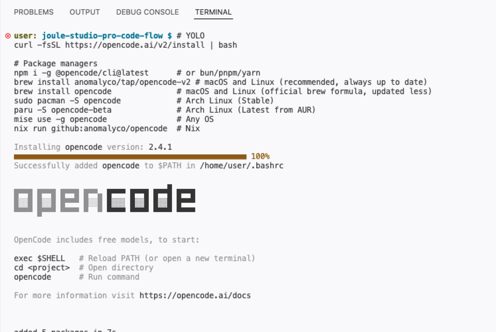
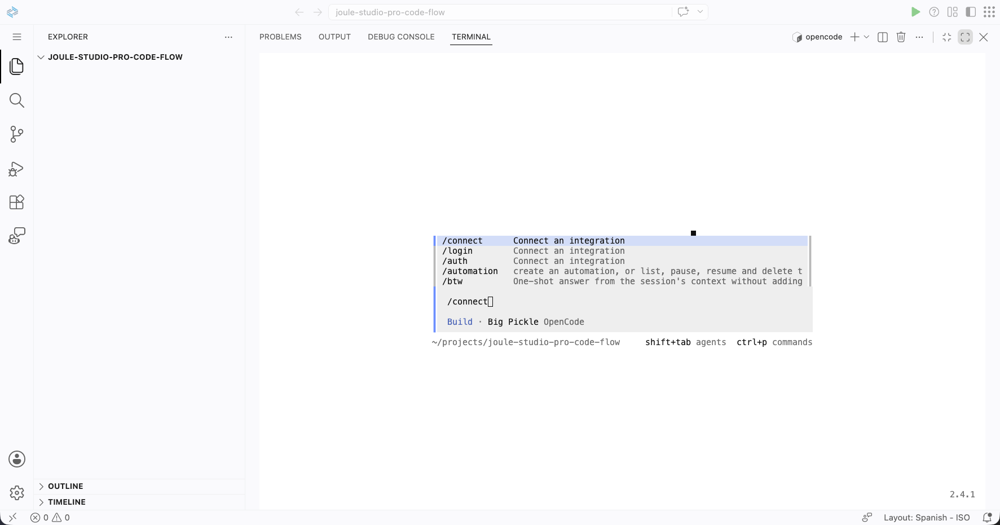
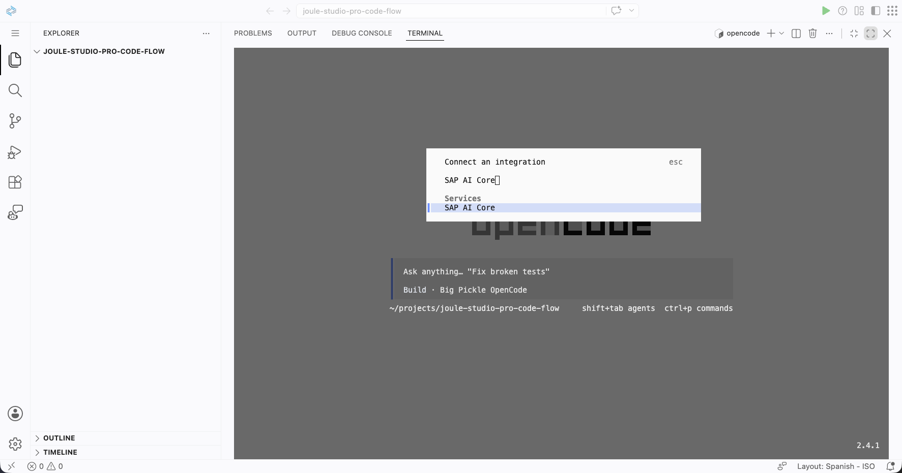
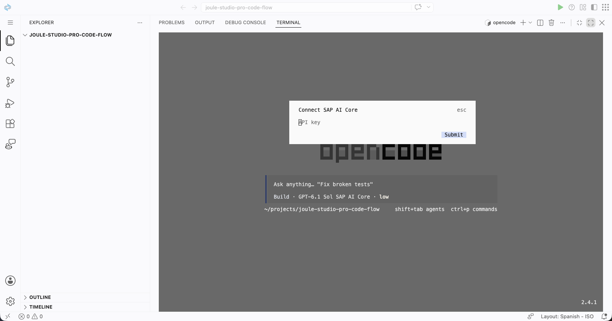
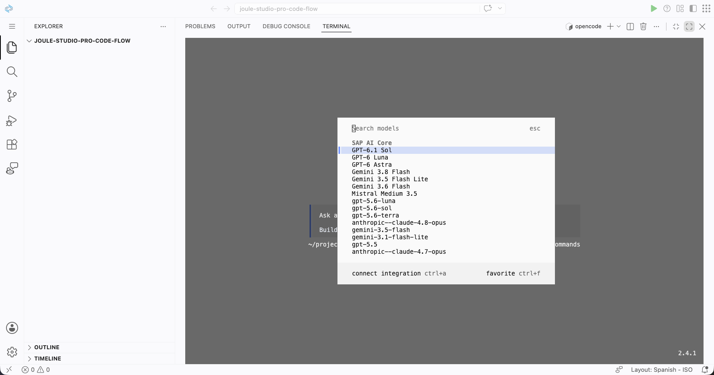
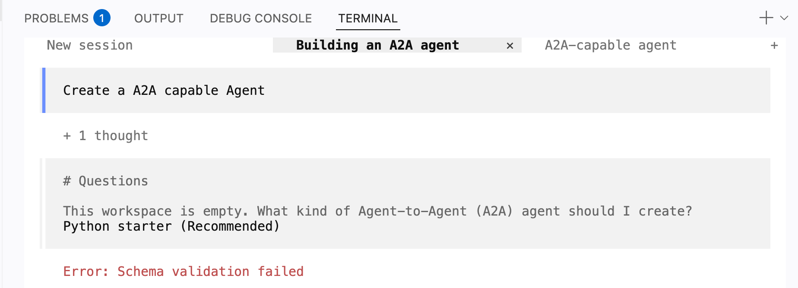
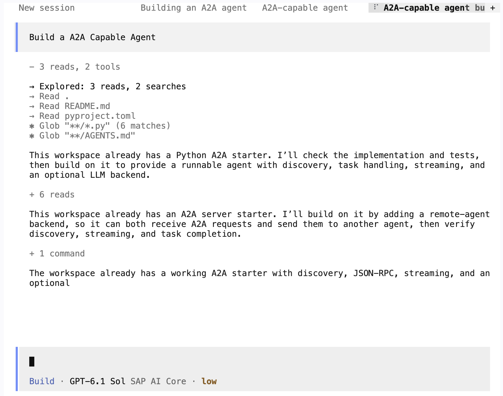

# Setting up OpenCode in Business Application Studio with SAP AI Core

Today we are looking at a quick setup of **OpenCode** in Business Application Studio, using **SAP AI Core** as the backbone for LLMs. This is useful if you want a coding agent fully enabled by BTP components — without any local installation on your machine. In general this also works in VS Code.

## Prerequisites

- Business Application Studio
- SAP AI Core instance + AI Core service key
- Resource Group exists in AI Core
- Orchestration Deployment exists in the Resource Group on AI Core

If you are unsure about the AI Core part, check out this tutorial: [Provisioning Generative AI Hub in SAP AI Core](https://developers.sap.com/tutorials/ai-core-genaihub-provisioning/).

## Install OpenCode

Basically, follow the [official installation guide](https://opencode.ai/docs/) — at the time of writing this is done with the following command:

```bash
curl -fsSL https://opencode.ai/install | bash
```



### Check if it's working

Just type:

```bash
opencode
```

and see how it loads up. If you are doing this on your local machine, make sure to add it to your shell config (`.bashrc` / `.zshrc`).

## Hook up SAP AI Core as integration

In OpenCode, use `/connect` to search for **SAP AI Core**. Here you need to hand in a service key and submit with Enter.



Search for SAP AI Core



Paste your AI Core Service Key



And select a model. It could be that you are also asked for the thinking effort. Here you will see all the models available in orchestration — see [SAP Note 3437766](https://me.sap.com/notes/3437766).



Then you can try it out and ask "Hi" — this might work.

For me the `/connect` flow didn't always stick, so the reliable route is to push the service key into the background service directly (use SINGLE quotes — the `$` in the clientsecret must stay literal):

```bash
# 1) Write the service key into the background service as an env var
opencode service set env AICORE_SERVICE_KEY '{"clientid":"<CLIENT_ID>","clientsecret":"<CLIENT_SECRET>","url":"https://<your-tenant>.authentication.sap.hana.ondemand.com","serviceurls":{"AI_API_URL":"https://<ai-api-host>.ml.hana.ondemand.com"}}'

# 2) Set the resource group
opencode service set env AICORE_RESOURCE_GROUP 'default'

# 3) Restart the service so it inherits the env
opencode service restart

# 4) Verify the credential was registered
opencode auth list | grep -i "sap ai core"
```

So: **first create the AI Core integration, then restart OpenCode with the new environment.** From here the credentials are set — but there is one more thing before the agent actually works.

## Hitting "Schema validation failed"?

The moment you ask for something real — build a plan, create an agent, use a tool — you will likely see the turn fall apart like this, with `Error: Schema validation failed` after every message:



A plain "hi" may still answer (with that error trailing behind it), but anything that makes the agent plan or call a tool dies and nothing renders. Third-party models (DeepSeek and friends) work fine, which makes it look like an AI Core problem — it isn't.

**TL;DR — you need an OpenCode config.** Create `opencode.json` (global at `~/.config/opencode/opencode.json`, or in your project root) with this one override, then `opencode service restart`:

```jsonc
{
  "$schema": "https://opencode.ai/config.json",
  "provider": {
    "sap-ai-core": {
      "npm": "@jerome-benoit/sap-ai-provider@5.1.2"
    }
  }
}
```

Nothing else changes — same service key, same models, same model IDs. That's the whole fix.

### Why this happens

OpenCode (≥ 2.4) talks to providers through the AI SDK **V3** interface, where a finish reason is an object `{ normalized, raw }` validated against a fixed set (`stop | length | tool-calls | content-filter | error | unknown`). But the model registry wires `sap-ai-core` to the provider's **V2** package, where the finish reason is a plain string. The V2→V3 bridge turns `"unknown"` (and anything it can't classify) into `"other"` — a value OpenCode's own schema rejects, so the turn is dropped.

The override above simply points `sap-ai-core` at the provider's **V3 package** (`@jerome-benoit/sap-ai-provider`) instead of the `-v2` one, which emits the object shape OpenCode expects. I pinned it to `5.1.2` (the version this post was tested on); drop the `@5.1.2` if you'd rather always pull the latest.

This is tracked upstream — [models.dev#14467](https://github.com/anomalyco/models.dev/issues/14467) (registry should point at the V3 package) and [opencode#66153](https://github.com/anomalyco/opencode/issues/66153) (the finish-reason bridge). Once either lands, you can drop the override entirely. Full write-up and a reproducible before/after script: [opencode-sap-ai-core-fix](https://github.com/fyx99/opencode-sap-ai-core-fix).

## The result

With the config in place, restart and the same prompt that blew up before now runs end to end — the agent explores the workspace, reads files, calls tools, and builds its plan, all on `GPT-6.1 Sol · SAP AI Core`:



From here you have a fully working coding agent on SAP AI Core — start it with `opencode`, pick your model with `/models` (e.g. `sap-ai-core/anthropic--claude-4.6-sonnet`, `sap-ai-core/gpt-6.1-sol`), and go.

## Alternative

Also check out the setup with Cline as an alternative: [Using Cline with SAP AI Core in VS Code — A Complete Setup Guide](https://community.sap.com/t5/tooling-sap-build-blog-posts/using-cline-with-sap-ai-core-in-vs-code-a-complete-setup-guide/ba-p/14301572).
